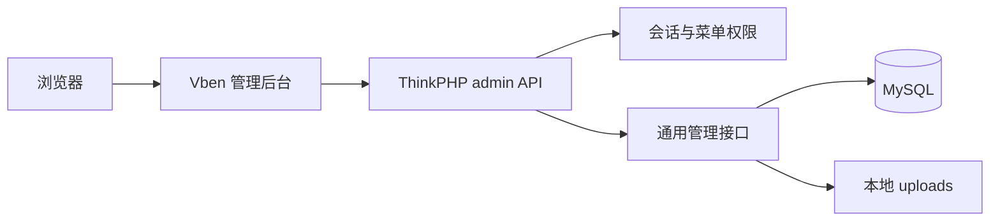

# 架构说明

后端采用 ThinkPHP 8 多应用结构，前端采用 Vben 5 / Vue 3 与 pnpm workspace。管理应用是 `frontend/apps/web-admin/`，共享组件及工具位于 `frontend/packages/` 和 `frontend/internal/`。

## 请求路径

前端使用相对 API 前缀 `/admin`。开发时由 `frontend/apps/web-admin/vite.config.mts` 代理到 `http://127.0.0.1:8000/index.php/admin`，`/uploads` 代理到同一后端。更改端口时同步调整代理和 `backend/config/cors.php` 中允许的来源。CORS 默认允许 `localhost:5689` 和 `127.0.0.1:5689`。

常规接口使用 `{code, message, data}` JSON 格式，错误同时使用对应 HTTP 状态码。上传响应还在顶层返回 `id`、`name`、`status`、`url`，由上传组件读取。`/` 和 `/health` 提供无需数据库的基础健康检查。

## 认证和权限

管理员登录使用用户名和密码，返回随机 Bearer token。数据库只保存 token 的 SHA-256 摘要，会话有效期为 8 小时；退出后删除会话，账号停用或密码更改后拒绝旧会话。前端关闭自动刷新，过期后重新登录。

后端按角色的菜单授权检查账号、角色、菜单、部门和设置接口。超级管理员角色标识为 `supperadmin`，是保留标识。工作台与个人中心向已认证账号开放，导航包含已授权菜单及必要父节点。账号管理不能将普通角色升级为超级管理员，写入字段使用白名单。

登录按 IP 和用户名限制失败重试；修改操作仅接受对应 HTTP 方法。审计记录操作者、模块、动作和 IP，不保存密码或完整请求体。

## 数据和上传

| 表 | 用途 |
| --- | --- |
| `admin_user` | 管理员账号 |
| `admin_role` | 角色 |
| `admin_menu` | 菜单和页面组件 |
| `admin_role_menu` | 角色菜单授权 |
| `admin_dept` | 部门 |
| `admin_token` | 会话摘要和到期时间 |
| `setting` | 公共设置 |
| `upload` | 上传元数据 |
| `audit_log` | 操作审计 |

实际表名加上 `DB_PREFIX` 配置。结构文件位于 `backend/database/migrations/`，按文件名执行并记录在 `migration` 表。应用默认采用 UTC 时区。

本地上传保存至 `backend/public/uploads/`，访问路径为 `/uploads`。允许限定图片、视频与 PDF；服务端检查类型、大小及 PDF 文件签名，列表按上传账号隔离。图片处理需要 GD 扩展。客户端原始文件名只用于展示，存储路径使用服务端生成的 ID 与 MD5。
